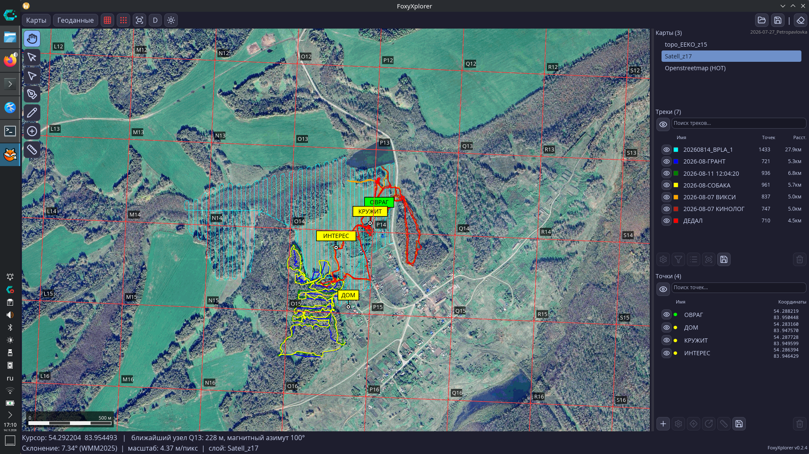

FoxyXplorer — картографическое приложение для локальных задач

Работа с картами ozf2+ozf.map, геоданными gpx, plt, wpt, ms, kml

  
  
  

- Загрузка отдельных карт и комплектов целиком в один клик, включая сетки привязки

- Чтение-запись: gpx, plt, ms, kml, wpt (c append)

- Редактирование свойств треков и точек

- Редактирование треков, рисование треков

- Создание маршрутных точек по координатам и проецированием

- Фильтрация по Дуглас-Пекер

- Поддержка OSM, Sentinel-2 Cloudless, ESRI World Imagery

- Совместимость с Ози

- Буква-С-хак

- Сохранение, загрузка сессий

- Linux (Appimage), Windows, MacOS

## Первый запуск и начало работы

При первом открытии вы уивидите карту OSM и пустые правые панели.

Для загрузки комплекта нажмите кнопку  "Карты" и выберите папку нужного вам комплекта карт (YYYY-MM-DD_Локация). Жмите кнопку Открыть. В списке "Карты" справа появятся все карты этого комплекта + OSM.

Если вам хочется загрузить только одну карту из комплекта, выберите соответствующую папку (например, 6-Ozi(Win&Android)_Satel).

Кнопками на верхней панели можно включать и выключать отображение сетки и подписей к ее узлам. Далее идут кнопка "Центрировать и показать всю площадь карты", кнопка переключения форматов координат и кнопка переключения светлой и темной тем.

Треки и точки загружаются кнопкой "Геоданные".  Они появятся в соответствующих списках справа.

В остальных функциях разбираться пока придется методом тыка, документация подъедет позже

------------------------------------------------------

Писано с Дипсик

Copyright (C) 2026 Grant Borodin

This program is free software: you can redistribute it and/or modify
it under the terms of the GNU General Public License as published by
the Free Software Foundation, version 3.

This program is distributed in the hope that it will be useful,
but WITHOUT ANY WARRANTY; without even the implied warranty of
MERCHANTABILITY or FITNESS FOR A PARTICULAR PURPOSE.  See the
GNU General Public License for more details.

You should have received a copy of the GNU General Public License
along with this program.  If not, see <https://www.gnu.org/licenses/>.

## Источники подложки

FoxyXplorer поддерживает три онлайн-источника подложки, переключаемых
в правой панели → «Карты». Помимо них, доступны локальные карты OZF2
из комплекта.

### OpenStreetMap (HOT)

- **URL:** `tile-a.openstreetmap.fr`
- **Лицензия:** данные — ODbL 1.0; тайлы — CC BY-SA 2.0
- **Атрибуция в приложении:** «© OpenStreetMap contributors, Tiles
  courtesy of Humanitarian OpenStreetMap Team»
- **Зум:** до z19

### Sentinel-2 cloudless

- **URL:** `tiles.maps.eox.at`
- **Источник данных:** мозаика Sentinel-2 L2A, подготовленная EOX IT Services GmbH
- **Лицензия:** CC BY 4.0
- **Атрибуция в приложении:** «Sentinel-2 cloudless by EOX IT Services GmbH
  (Contains modified Copernicus Sentinel data 2024) — CC BY 4.0»
- **Зум:** нативный максимум z14; при большем приближении используется
  программное увеличение (overzoom) тайлов z14
- **Ссылка:** https://cloudless.eox.at

### ESRI World Imagery

- **URL:** `server.arcgisonline.com`
- **Условия использования:** доступ через публичный REST-сервис ESRI
  без API-ключа. Автор проекта имеет бесплатный аккаунт ArcGIS Online.
- **Атрибуция в приложении:** «Sources: Esri, DigitalGlobe, GeoEye,
  i-cubed, USDA FSA, USGS, AEX, Getmapping, Aerogrid, IGN, IGP,
  swisstopo, and the GIS User Community»
- **Зум:** до z19; при большем приближении — overzoom тайлов z19
- **Некоммерческий характер:** FoxyXplorer не приносит дохода и создан
  для содействия поисковым работам. Использование не направлено на
  извлечение прибыли.

#### Дисклеймер по ESRI

Тайлы предоставляются «как есть». Автор приложения не гарантирует их
доступность, точность или актуальность и не несёт ответственности за
возможные перебои в работе сервиса ESRI. Доступность тайлов может
различаться по регионам и не гарантируется.

### Кэширование и нагрузка

Все тайлы кэшируются локально (диск и память), чтобы минимизировать
нагрузку на серверы провайдеров. Кэш разделён по источнику:
`~/.cache/foxy/osm/…`, `~/.cache/foxy/s2/…`, `~/.cache/foxy/esri/…`.

Автоматическая очистка: старше 90 дней или при превышении 2 ГБ.
