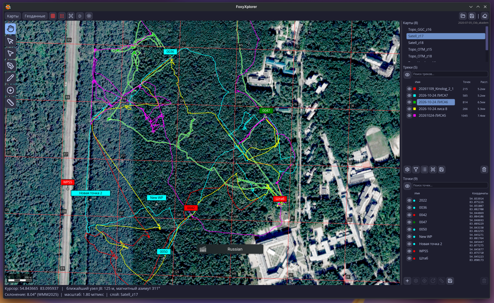
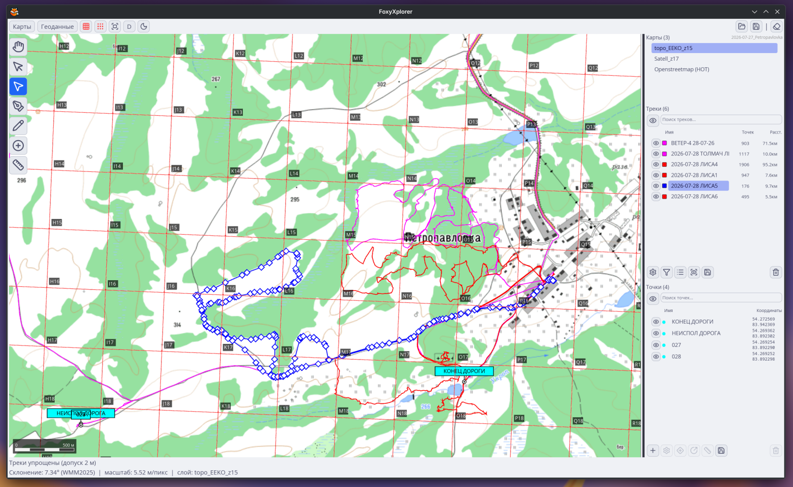
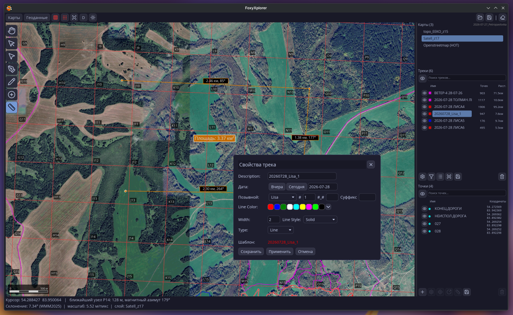

FoxyXplorer — картографическое приложение для локальных задач

Работа с картами ozf2+ozf.map, геоданными gpx, plt, wpt, ms

  
  
  

Загрузка отдельных карт и комплектов целиком в один клик, включая сетки привязки

Чтение-запись: gpx, plt, ms, kml, wpt (c append)

Редактирование свойств треков и точек

Редактирование треков, рисование треков

Создание маршрутных точек по координатам и проецированием

Фильтрация по Дуглас-Пекер

Поддержка OSM

Совместимость с Ози

Буква-С-хак

Сохранение, загрузка сессий

Linux (Appimage), Windows, MacOS

------------------------------------------------------
Первый запуск и начало работы
------------------------------------------------------

При первом открытии вы уивидите карту OSM и пустые праве панели.

Для загрузки комплекта нажмите кнопку "Карты" и зайдите в папку нужного вам комплекта карт (YYYY-MM-DD_Локация). Больше ничего не требуется, жмите кнопку Открыть. В списке "Карты" справа появятся все карты этого комплекта + OSM.

Если вам хочется загрузить только одну карту из комплекта, заходите в соответствующую папку (например, 6-Ozi(Win&Android)_Satel) и, как и в первом случае, жмите Открыть.

Кнопками на верхней панели можно включать и выключать отображение сетки и подписей к ее узлам. Далее идут кнопка "Центрировать и показать всю площадь карты", кнопка переключения форматов координат и кнопка переключения светлой и темной тем.

Треки и точки загружаются кнопкой "Геоданные". Диалоговое окно отображает только поддерживаемые форматы. Открывать можно по одному и помногу. Они появятся в соответствующих списках справа.

------------------------------------------------------

Писано с Дипсик

Copyright (C) 2026 Grant Borodin

This program is free software: you can redistribute it and/or modify
it under the terms of the GNU General Public License as published by
the Free Software Foundation, version 3.

This program is distributed in the hope that it will be useful,
but WITHOUT ANY WARRANTY; without even the implied warranty of
MERCHANTABILITY or FITNESS FOR A PARTICULAR PURPOSE.  See the
GNU General Public License for more details.

You should have received a copy of the GNU General Public License
along with this program.  If not, see <https://www.gnu.org/licenses/>.
