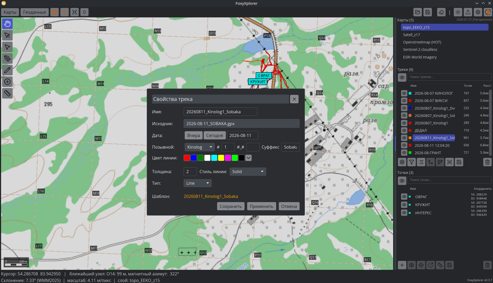
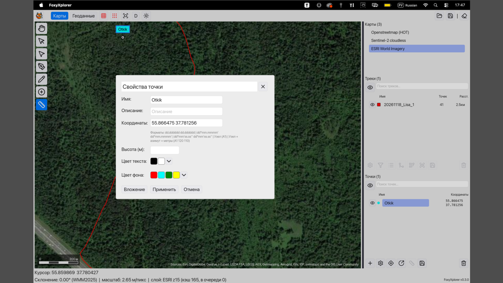

# FoxyXplorer — картографическое приложение для локальных задач

Работа с картами ozf2+ozf.map, геоданными gpx, plt, wpt, ms, kml, fit

📖 **[Руководство пользователя](docs/user-guide.md)**

  
  
  

- Загрузка отдельных карт и комплектов целиком в один клик, включая сетки привязки и метки Wikimapia

- Чтение-запись: gpx, plt, ms, kml, wpt (c append); FIT Activity/Course (импорт), FIT Course (экспорт одного трека с точками маршрута)

- Редактирование свойств треков и точек

- Редактирование треков, рисование треков

- Создание маршрутных точек по координатам и проецированием

- Инструменты для измерения

- Фильтрация по Дуглас-Пекер

- Поддержка OSM, Sentinel-2 Cloudless, ESRI World Imagery

- Дополнительный цветной слой высот Copernicus DEM GLO-30 с адаптивной легендой

- Магнитное склонение для текущей локации (WMM2025)

- Встроенный [http сервер](docs/FoxyDrop.md) для загрузки треков по локальной сети с мобильных устройств

- Встроенный [ftp клиент](docs/FoxyUpload.md) для загрузки треков и точек на сервер

- Совместимость с Ози

- Буква-С-хак, время в wpt по координатам точек

- Сохранение, загрузка сессий

- Русский, английский интерфейс

- Linux (Appimage), Windows, MacOS

------------------------------------------------------

Писано с ИИ по методу "чистая комната"

Copyright (C) 2026 Grant Borodin

------------------------------------------------------

This program is free software: you can redistribute it and/or modify
it under the terms of the GNU General Public License as published by
the Free Software Foundation, version 3.

This program is distributed in the hope that it will be useful,
but WITHOUT ANY WARRANTY; without even the implied warranty of
MERCHANTABILITY or FITNESS FOR A PARTICULAR PURPOSE.  See the
GNU General Public License for more details.

You should have received a copy of the GNU General Public License
along with this program.  If not, see <https://www.gnu.org/licenses/>.

------------------------------------------------------

## Источники подложки

FoxyXplorer поддерживает три онлайн-источника подложки, переключаемых
в правой панели → «Карты». Помимо них, доступны локальные карты OZF2
из комплекта.

### OpenStreetMap (HOT)

- **URL:** `tile-a.openstreetmap.fr`
- **Лицензия:** данные — ODbL 1.0; тайлы — CC BY-SA 2.0
- **Атрибуция в приложении:** «© OpenStreetMap contributors, Tiles
  courtesy of Humanitarian OpenStreetMap Team»
- **Зум:** до z19

### Sentinel-2 cloudless

- **URL:** `tiles.maps.eox.at`
- **Источник данных:** мозаика Sentinel-2 L2A, подготовленная EOX IT Services GmbH
- **Лицензия:** CC BY 4.0
- **Атрибуция в приложении:** «Sentinel-2 cloudless by EOX IT Services GmbH
  (Contains modified Copernicus Sentinel data 2024) — CC BY 4.0»
- **Зум:** нативный максимум z14; при большем приближении используется
  программное увеличение (overzoom) тайлов z14
- **Ссылка:** https://cloudless.eox.at

### ESRI World Imagery

- **URL:** `server.arcgisonline.com`
- **Условия использования:** доступ через публичный REST-сервис ESRI
  без API-ключа. Автор проекта имеет бесплатный аккаунт ArcGIS Online.
- **Атрибуция в приложении:** «Sources: Esri, DigitalGlobe, GeoEye,
  i-cubed, USDA FSA, USGS, AEX, Getmapping, Aerogrid, IGN, IGP,
  swisstopo, and the GIS User Community»
- **Зум:** до z19; при большем приближении — overzoom тайлов z19
- **Некоммерческий характер:** FoxyXplorer не приносит дохода и создан
  для содействия поисковым работам. Использование не направлено на
  извлечение прибыли.

#### Дисклеймер по ESRI

Тайлы предоставляются «как есть». Автор приложения не гарантирует их
доступность, точность или актуальность и не несёт ответственности за
возможные перебои в работе сервиса ESRI. Доступность тайлов может
различаться по регионам и не гарантируется.

### Copernicus DEM GLO-30 (слой высот)

- **Источник:** Copernicus Digital Elevation Model (DEM), GLO-30 Public
- **Данные:** цифровая модель поверхности (DSM), около 30 м; возможны
  пропуски, а высоты могут включать деревья и здания
- **Хранение:** исходные числовые данные загружаются выборочно из
  Cloud Optimized GeoTIFF и кэшируются отдельно в `~/.cache/foxy/dem/glo30/…`
- **Атрибуция на карте:** «Copernicus DEM GLO-30 © DLR / Airbus — EU / ESA»;
  при включении поверх онлайн-подложки выводится отдельной строкой над
  атрибуцией выбранного источника
- **Лицензия и правовые условия:**
  https://dataspace.copernicus.eu/explore-data/data-collections/copernicus-contributing-missions/collections-description/COP-DEM

Обязательное уведомление для адаптированных данных Copernicus WorldDEM-30:

> produced using Copernicus WorldDEM-30 © DLR e.V. 2010-2014 and © Airbus
> Defence and Space GmbH 2014-2018 provided under COPERNICUS by the
> European Union and ESA; all rights reserved

Обязательное уведомление об ограничении ответственности:

> The organisations in charge of the Copernicus programme by law or by
> delegation do not incur any liability for any use of the Copernicus
> WorldDEM-30

Copernicus не является общественным достоянием. Использование данных
не подразумевает официального одобрения FoxyXplorer организациями
Copernicus, ЕС, ESA, DLR или Airbus. При распространении приложения
эти правовые сведения должны оставаться доступны пользователям.

### Кэширование и нагрузка

Все тайлы кэшируются локально (диск и память), чтобы минимизировать
нагрузку на серверы провайдеров. Кэш разделён по источнику:
`~/.cache/foxy/osm/…`, `~/.cache/foxy/s2/…`, `~/.cache/foxy/esri/…`.

Автоматическая очистка: старше 90 дней или при превышении 2 ГБ.
