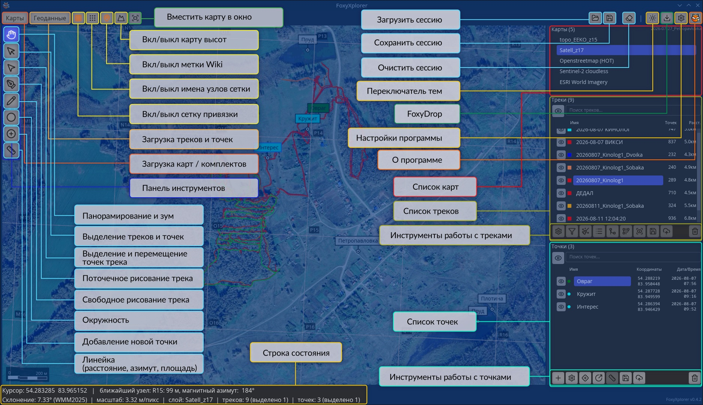
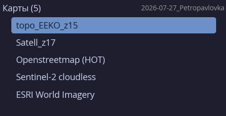
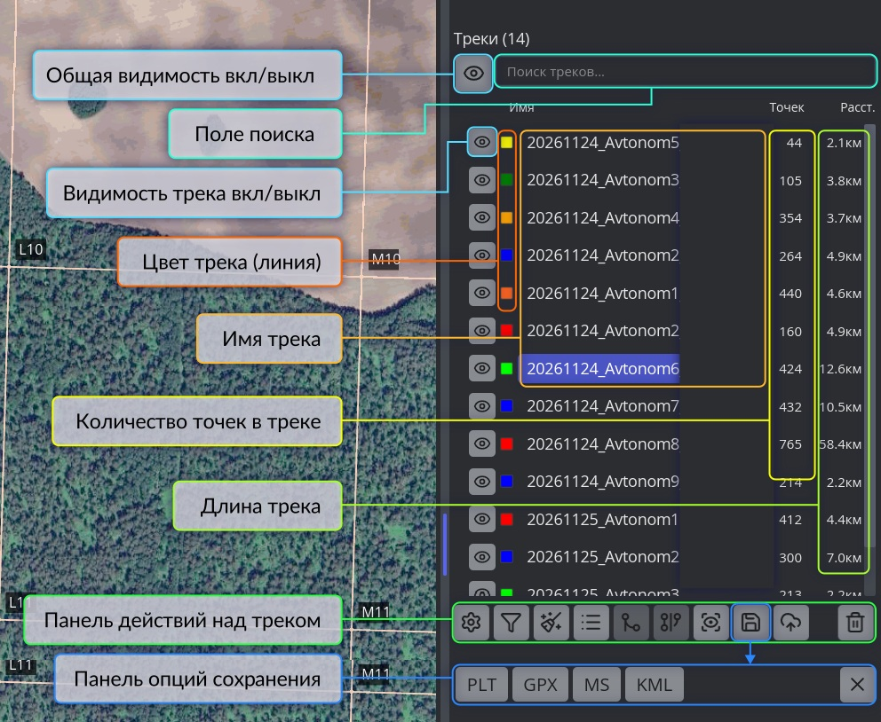
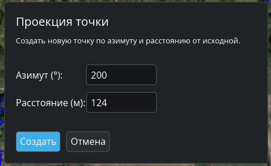
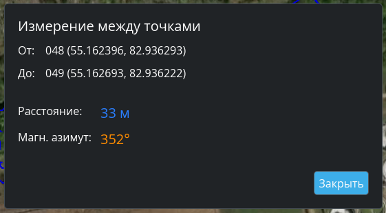
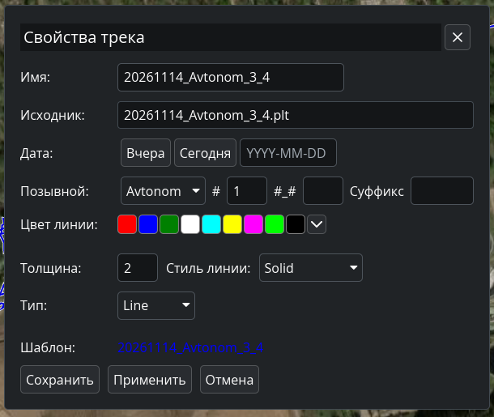
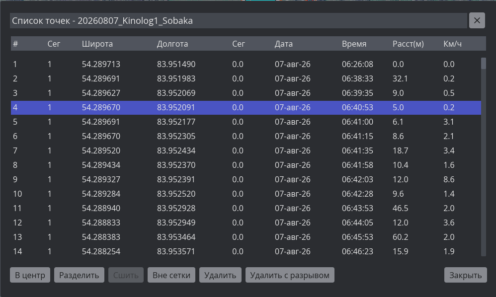
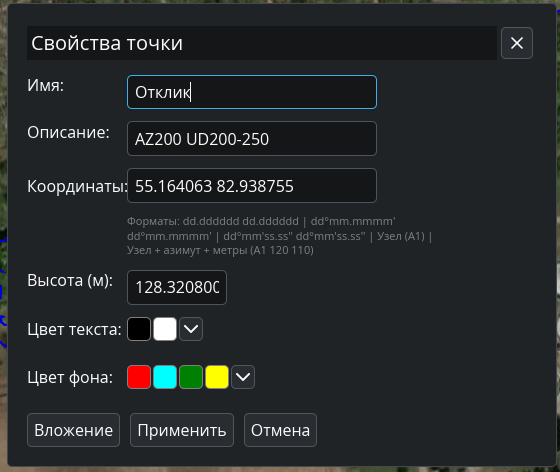

**Внимание! Некоторые функции последних версий еще не описаны. WIP**

Главное окно FoxyXplorer

### Верхняя панель

- Кнопка "Карты" служит для загрузки комплектов карт или отдельных карт. Чтобы загрузить комплект, выберите корневую папку комплекта (**ГГГГ-ММ-ДД_Локация)** и нажмите "Открыть". 
  Чтобы открыть отдельно карту из комплекта, выберите папку этой карты (напр, **6-Ozi(Win&Android)_Satell)** и нажимте "Открыть".
  Карты отобразятся в правой панели в списке "Карты". Список позволяет выбрать активный слой.
  Одновременно с картами  загружается сетка привязки. Узлы сетки привязки не отображаются в списке "Точки"
  Одновременно эта же сетка копируется в папку 10-Tracks выбранного комплекта.

- Кнопка "Геоданные" позволяет загружать треки и точки в форматах GPX, PLT, WPT, MS, KML и FIT. Загруженные объекты отобразятся в правой панели в списках  "Треки"" и "Точки". Горячая клавиша - **Ctrl-G**.

- Кнопка "Переключение видимости сетки" позволяет скрывать и показывать сетку привязки.

- Кнопка "Переключение видимости узлов" позволят скрывать и показывать имена узлов сетки.

- Кнопка "Переключение видимости меток Wiki"  включает и выключает отображение данных Wikimapia (если есть в комплекте).

- Кнопка "Переключение видимости карты высот" - включает и выключает онайлн-карту высот, нормализованную под область текущую область видимости.

- Кнопка "Вместить карту в экран". Очевидно.

- Кнопка "Загрузить сессию" позволяет загрузить сохраненную сессию из файла. Горячая клавиша - **Ctrl-O**.

- Кнопка "Сохранить сессию" позволяет сохранить текущую сессию. Горячая клавиша - **Ctrl-S**.

- Кнопка "Очистить сессию" позволяет удалить все содержимое, включая карты, треки и точки и начать работу с чистого листа.

- Кнопка "Переключение темы" позволяет переключать светлую и темную темы интерфейса. Глобально тема выбирается в настройках.

- Кнопка "FoxyDrop". [Подробнее здесь](FoxyDrop.md).

- Настройки программы (язык, стартовая локация, допуск упрощения, тема,  папка FoxyDrop, настройки FoxyUpload,  выбор  цвета сетки )

- О программе (ссылки, версия)

### Панель инструментов

Включает:

- Панорамирование и зум. Горячие клавиши - **Q**  или, для временного переключения при работе с другим инструментом - **Пробел** (зажать и удерживать).  Дополнительно панорамирование осуществляется в любом режиме **средней кнопой мыши**.

- Выбор объектов. Позволяет выбирать на карте (кликом и рамкой) объекты верхнего уровня - треки и точки - для дальнейших манипуляций с ними. С модификатором **Alt** рамка отменяет выделение.  **Delete** удаляет выбранные объекты. Горячая клавиша - **S**. 
  Клик на свободном месте отменяет выделение всех выделенныъ объектов (это также делается  горячей клавишой **Ctrl-D**)

- Выбор, перемещение  и удаление точек трека. С модификатором Ctrl добавляет точки к выделению (или снимает выделение), с модификатором Shift - выделяет диапазон точек от предыдущей до выделенной.  Выделение рамкой с **Alt** отменяет выделение.  **Delete** удаляет выбранные точки без сегментации трека. **Shift-Delete** и **Shift-Backspace** создают разрыв на месте удаленного участка.  Горячая клавиша - **D**.

- Поточечное рисование трека. Последовательными кликами рисуем трек, завершение рисования - **Enter**,  отмена - **Escape**. Горчая клавиша **T**.

- Свободное рисование трека. Зажимаем ЛКМ и рисуем по карте. Горячая клавиша - **F**.

  Оба инструмента добавляют новый трек к выделенному на момент начало рисования (дорисовывают его), если первый клик / мув рисования выполнить с модификатором **Shift.**. Все точки модифицированных таким образом треков утрачивают всю информацию, кроме координат.

- Окружность. Первый клик задает центр, движение мыши - радиус. Второй клик фиксирует окружность. Пока инструмент активен, радиус окружности можно менять. **Enter** создает трек типа "Полигон", **Escape** отменяет создание.

- Добавление новой точки. Добавляет маршрутную точку в произвольном месте с вызовом модального окна "Свойства точки". Горячая клавиша **W**.

- Линейка. Позволяет измерять расстояние и магнитный азимут, а также площадь описываемой области общую длину. Горячая клавиша **R**. Сброс - **Escape**.

### Правая панель - список карт

Здесь отображаются загруженные карты + онлайн-карты (OSM, Sentinel-2, ESRI).  Переключение между слоями кликом.  В правом верхнем углу - имя текущего комплекта. 

Оффлайн-карты загружаются из их текущего положения, поэтому не стоит перемещать / удалять их между сессиями.

Онлайн-карты кэшируются в:

**Linux:** 

`~/.cache/foxy/osm/z/x/y.png
~/.cache/foxy/s2/z/x/y.jpg
~/.cache/foxy/esri/z/x/y.jpg`

**Windows:**

`C:\Users\<user>\AppData\Local\foxy\osm\z\x\y.png
C:\Users\<user>\AppData\Local\foxy\s2\z\x\y.jpg
C:\Users\<user>\AppData\Local\foxy\esri\z\x\y.jpg`

**MacOS:**

`/Users/<user>/Library/Caches/foxy/osm/z/x/y.png
/Users/<user>/Library/Caches/foxy/s2/z/x/y.jpg
/Users/<user>/Library/Caches/foxy/esri/z/x/y.jpg`

Автоматическая очистка: старше 90 дней или при превышении 2 ГБ.

### Правая панель - список треков

В целом картинка все объясняет. Нужно добавить, что клик по иконке видимости трека с модификатором **Alt** оставляет видимым только этот трек.

В поле "Имя"" отображается не имя файла-исходника, а значение поля  name (GPX) и track description (PLT).  Двойной клик на имени трека вызывает окно "Свойства трека" (имя, цвет толщина и тд, см. ниже)

#### Панель действий над треком

Кнопки в этой панели контекстно-зависимые и активируются при выполнении необходимых для данной операции условий

- Свойства трека - аналогично двойному клику на имени, вызывает модальное окно "Свойства трека". Выбран один трек.

- Фильтрация трека по алгоритму Дугласа-Пекера, порог упрощения по умолчанию эмпирически подобран, чтобы соответствовать  фильтрации Ozi с Filter Index = 4. Это значение можно изменить в настройках приложения. Выбран один трек и более.

- Очистка трека. Удаление артефактов и восстановление хронологического порядка точек трека. Треки со сбитой хронологией восстанавливаются автоматически, треки с выбросами и другими артефактами записи предлагается очищать вручную после выделения проблемных участков. Пользоваться этой функцией следует с осторожностью и помнить об Undo. [Подробнее здесь](recovery.md)

- Вызывает модальное окно "Список точек" (см. ниже). Выбран один трек.

- Объединить выбранные треки в один (как сегменты). Выбраны два или более треков.

- Разделить трек посегментно. Выбран трек, содержащий сегменты.

- Вместить трек в окно. Выбран один и более треков.

- Загрузить трек или треки на сервер. См. [FoxyUpload](FoxyUpload.md)

- Сохранить трек / треки. Раскрывает панель опций сохранения: PLT (один трек), GPX, MS, KML (один или несколько треков и/или точек), FIT Course (ровно один трек и, при необходимости, выбранные точки).

- Удалить. Удаляет выбранные треки.

### Правая панель - список точек (waypoints)

В целом аналогична списку треков по функционалу. Двойной клик по имени точки вызывает окно свойств (см. ниже)

#### Панель действий над точками

- Добавить новую точку. Создает новую точку по центру экрана и раскрывает модальное окно Свойства точки. Кнопка "Отмена" в это окне или Escape отменяют создание.  Не зависит от выбора в списке.

- Свойства точки - модальное окно (см. ниже). Выбрана одна точка.

- Переместиться к выбранной точке. Помещает выбранную точку в центр экрана и помечает ее прицелом, который исчезает через 3 секунды. Выбрана одна точка.

- Проекция точки. Создает новую точку по магнитному азимуту и удалению от исходной (в модальном окне). Выбрана одна точка.

- Измерение расстояния и магнитного азимута. Выбраны две точки, азимут берется с первой выбранной на вторую.

- Загрузить точки на сервер. На первом шаге предлагает сохранить выбранные точки в новый файл или добавить в существующий, далее см. [FoxyUpload](FoxyUpload.md)
- Сохранить точку / точки. Раскрывает панель опций сохранения: WPT - сохранить выбранные точки в новый файл wpt, WPT+ - добавить выбранные точки в существующий файл wpt (обе опции доступны, если выбраны только точки, без треков), GPX, MS, KML, FIT (при одном выбранном треке).
- Удалить. Удаляет выбранные точки.

### Клавиша TAB...

... скрывает и показывает обратно верхнюю и правую панели

### Модальные окна

#### Свойства трека

Вызывается двойным кликом по имени трека в списке, из контекстного ПКМ или кнопкой в списке треков

- Поле "Имя". При загрузке заполняется из поля  name (GPX) и track description (PLT). В дальнейшем может быть отредактировано вручную либо с помощью полей шаблона (см. ниже). При сохранении предлагается как имя файла по умолчанию

- Поле "Исходник". Имя исходного файла, при наведении отображается полный путь к исходному файлу. Поле read only, но допускает выборочное копирование

  Далее идут поля шаблона. Идея шаблона с благодарностью перенесена из превосходного приложения **OK Helper**.

- Поле "Дата". Указанная здесь дата автоматически подставляется в поле "Имя". Можно воспользоваться кнопками "Вчера" и "Сегодня", либо ручным вводом. Принимаются форматы YYYYMMDD и YYYY-MM-DD

- Раскрывающийся список "Позывной" позволяет выбрать одно из нескольких значений (Lisa, Avtonom, BPLA итд ), а так же нумерацию (численные значения полей) и суффикс (произвольное). Все эти данные подставляются в поле "Имя" в соответствие со стандартом ОК. 

- Строка основных цветов + раскрывающаяся палитра. При выборе позывного допустимый цвет подставляется автоматически, но в известных пределах может быть затем изменен здесь.

- Строка настроек линии трека.

- Выбор типа трека. При выборе типа "Polygon" становятся доступны дополнительные настройки.

- В строке "Шаблон" отображается превью имени файла

- Кнопка "Сохранить" - открывает диалог сохранения PLT, по умолчанию в 10.Tracls загруженного проекта.

- Кнопка "Применить" применяет выбранные настройки к треку и закрывает окно.

- Кнопка "Отмена" (Escape) откатывает все изменения и закрывает окно.

#### Список точек

Окно вызывается кнопкой в списке треков. или из контекстного ПКМ. При этом отображаются все точки трека на карте. Shift-клик выбирает диапазон точек, Ctrl-клик добавляет точки к выделению.

Выделение в списке синхронизировано с инструментом "Выбор точек трека (D)". Если выделить точку/точки этим инструментом на карте и открыть "Список точек трека", то список центрируется на первой по порядку точке из выделенных.

- Кнопка "В центр" центрирует выбранную точку (или множество выбранных) на карте и отмечает ее знаком прицела

- Кнопка "Разделить" режет трек на сегменты по выбранной точке (или первой в списке из множества выбранных).  Важно: разделение происходит в рамках существующего трека, новый трек не создается.

- Кнопка "Сшить" объединяет сегменты и требует выбора последней и первой точек двух соседних сегментов.

- Кнопка "Вне сетки" выделяет все точки трека за пределами сетки привязки.

- Кнопка "Удалить" удаляет все выбранные точки, соединяя их уцелевших соседей отрезком.

- Кнопка "Удалить с разрывом" удаляет выбранные точки, создавая разрыв и сегментируя трек.

Большая часть операций дублируется в контекстном меню **ПКМ** над треком, однако в нем присутствует и одна дополнительная - "Разделить здесь". Трек режется в точке клика на два новых, новый трек добавляется в список с суффиксом  _Сегмент2.

#### Свойства точки (waypoint)

Вызывается кнопкой в списке точек и из контекстного ПКМ, а так же при создании новой точки любым способом, и  отображает основные свойства точки. Допускает ввод любых кириллических символов, включая "С", в поля "Имя" и "Описание".
При выборе определенной категории из списка точке присваивается связанные с этой категорией цвет и  иконка на сервере (в приложении не отображается).

Значение в поле "Азимут" определяет поворот иконки категории на карте Latracks.

Следует отметить, что поле "Координаты" допускает ввод в трех основных форматах и в формате ИМЯ_УЗЛА_СЕТКИ + Азимут на него + Удаление от него (напр. G8 120 134, а при вводе только имени узла точка будет выставлена строго на нем). 
Кроме того, поскольку символ ° на клавиатуре, как правило, отсутствует, допускается ввод вида 55o45'32.78'' (с латинской "o" вместо градуса)

- Кнопка "Применить" закрывает окно с применением внесенных изменений.

- Кнопка "Отмена" (Escape) отменяет все изменения (и создание новой точки) и закрывает окно.

#### Замечание относительно узлов сетки и меток Wiki

Хотя узлы сетки и метки Wiki видны на карте, они не отображаются в списке точек в правой панели и с ними нельзя выполнять соответствующие операции. Существует возможность выборочно превратить любой узел сетки или метку Wiki в  обычную точку, если возникает такая необходимость - нужно щелкнуть на нем **ПКМ** и в контекстном меню выбрать "Добавить на карту".

### Очистка треков

В FoxyXplorer реализована начальная поддержка очистки треков.  Функция доступна в панели треков и в контекстном меню **ПКМ**. Треки со сбитой хронологией восстанавливаются автоматически, треки с выбросами и другими артефактами записи предлагается очищать вручную после выделения проблемных участков. Пользоваться этой функцией следует с осторожностью и помнить об Undo. [Подробнее здесь](recovery.md)

### Сессии

Все загруженные геоданные и ссылка на используемый комплект карт сохраняются автоматически при закрытии программы и каждые 5 минут во избежание потери информаци. Кнопки в правой части верхней панели позволяет сохранить текущую сессию в файл, загрузить ее и очистить (сбросить к исходному состоянию).

Геоданные (треки и точки) хранятся непосредственно в приложении. Это означает, что после загрузки исходные файлы могут быть удалены / перемещены / переименованы без потери информации. Из приложения они удаляются только пользователем.

Это не касается карт из комплекта, дублировать такой большой объем представляется неразумным.

Автосохраненные файлы сессий:

**Linux:** ~/.config/foxy/session.json

**Windows:**  C:\Users\<Имя_пользователя>\AppData\Roaming\foxy\session.json

**MacOS:**  /Users/<Имя_пользователя>/Library/Application Support/foxy/session.json

### Undo | Redo

Большинство операций  поддерживают Undo| Redo  в 50 шагов, однако история не сохраняется в рамках сессии.
