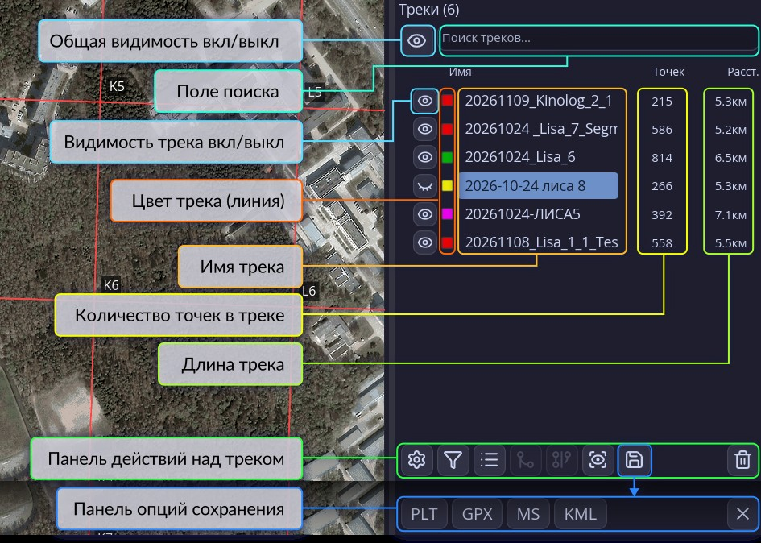
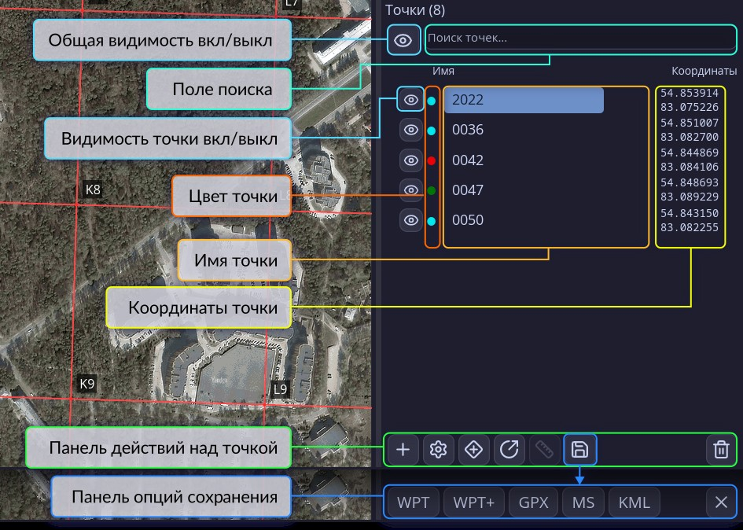

Главное окно FoxyXplorer

### Верхняя панель

- Кнопка "Карты" служит для загрузки комплектов карт или отдельных карт. Чтобы загрузить комплект, выберите корневую папку комплекта (ГГГГ-ММ-ДД_Локация) и нажмите "Открыть". 
  Чтобы открыть отдельно карту из комплекта, выберите папку этой карты (напр, 6-Ozi(Win&Android)_Satell) и нажимте "Открыть".
  Карты отобразятся в правой панели в списке "Карты". Список позволяет выбрать активный слой.
  Одновременно с картами загружается сетка привязки. Узлы сетки привязки не отображаются в списке "Точки"

- Кнопка "Геоданные" позволяет загружать треки и точки в форматах GPX. PLT, WPT, MS и KML. Загруженные объекты отобразятся в правой панели в списка "Треки"" и "Точки". Горячая клавиша - **Ctrl-G**.

- Кнопка "Переключение видимости сетки" позволяет скрывать и показывать сетку привязки.

- Кнопка "Переключение видимости узлов" позволят скрывать и показывать имена узлов сетки.

- Кнопка "Переключение форматов координат" переключает по циклу форматы dd.dddddd, dd°mm.mmm', dd°mm'ss.ss" в статусной строке и в списке точек

- Кнопка "Переключение темы" позволяет переключать светлую и темную темы интерфейса

- Кнопка "Загрузить сессию" позволяет загрузить сохраненную сессию из файла. Горячая клавиша - **Ctrl-O**.

- Кнопка "Сохранить сессию" позволяет сохранить текущую сессию. Горячая клавиша - **Ctrl-S**.

- Кнопка "Очистить сессию" позволяет удалить все содержимое, включая карты, треки и точки и начать работу с чистого листа

### Панель инструментов

Включает:

- Панорамирование и зум. Горячие клавиши - **Q**  или, для временного переключения при работе с другим инструментом - **Пробел** (зажать и удерживать).

- Выбор объектов. Позволяет выбирать на карте объекты верхнего уровня - треки и точки - для дальнейших манипуляций с ними. **Delete** удаляет выбранные объекты. Горячая клавиша - **S**. 
  Клик на свободном месте отменяет выделение (это также делается  горячей клавишой **Ctrl-D**)

- Выбор, перемещение  и удаление точек трека. С модификатором Ctrl добавляет точки к выделению, с модификатором Shift - выделяет диапазон точек от предыдущей до выделенной.  **Delete** удаляет выбранные точки.  Горячая клавиша - **D**.

- Поточечное рисование трека. Последовательными кликами рисуем трек, завершение рисования - **Enter**,  отмена - **Escape**. Горчая клавиша **T**.

- Свободное рисование трека. Зажимаем ЛКМ и рисуем по карте. Горячая клавиша - **F**.

- Добавление новой точки. Добавляет маршрутную точку в произвольном месте с вызовом модального окна Свойства точки. Горячая клавиша **W**.

- Линейка. Позволяет измерять расстояние и магнитный азимут, а также площадь описываемой области. Горячая клавиша **R**.

### Правая панель - список карт

Здесь отображаются загруженные карты + онлайн-карты (OSM, Sentinel-2, ESRI).  Переключение между слоями кликом.  В правом верхнем углу - имя текущего комплекта. 

### Правая панель - список треков

В целом картинка все объясняет. Нужно добавить, что клик по иконке видимости трека с модификатором **Alt** оставляет видимым только этот трек.

В поле "Имя"" отображается не имя файла-исходника, а значение поля  name (GPX) и track description (PLT).  Двойной клик на имени трека вызывает окно "Свойства трека" (имя, цвет толщина и тд, см. ниже)

#### Панель действий над треком

Кнопки в этой панели контекстно-зависимые и активируются при выполнении необходимых для данной операции условий

- Свойства трека - аналогично двойному клику на имени, вызывает модальное окно "Свойства трека". Выбран один трек.

- Фильтрация трека по алгоритму Дугласа-Пекера, аналогичная фильтрации Ozi с Filter Index = 4. Без параметров. Выбран один трек и более.

- Вызывает модальное окно "Список точек" (см. ниже). Выбран один трек.

- Объединить выбранные треки в один (как сегменты). Выбраны два или более треков.

- Разделить трек посегментно. Выбран трек, содержащий сегменты.

- Вместить трек в окно. Выбран один и более треков.

- Сохранить трек / треки. Раскрывает панель опций сохранения: PLT (выбран один трек), GPX, MS, KML (выбран один или несколько треков + точки в списке ниже).

### Правая панель - список точек (waypoints)

В целом аналогична списку треков по функционалу. Двойной клик по имени точки вызывает окно свойств (см. ниже)

#### Панель действий над точками

- Добавить новую точку. Создает новую точку по центру экрана и раскрывает модальное окно Свойства точки. Кнопка "Отмена" в это окне или Escape отменяют создание.  Не зависит от выбора в списке.

- Свойства точки - модальное окно (см. ниже). Выбрана одна точка.

- Переместиться к выбранной точке. Помещает выбранную точку в центр экрана и помечает ее прицелом, который исчезает через 3 секунды. Выбрана одна точка.

- Проекция точки. Создает новую точку по магнитному азимуту и удалению от исходной (в модальном окне). Выбрана одна точка.

- Измерение расстояния и магнитного азимута. Выбраны две точки, азимут берется с первой выбранной на вторую.

- Сохранить точку / точки. Раскрывает панель опций сохранения: WPT - сохранить выбранные точки в новый файл wpt, WPT+ - добавить выбранные точки в существующий файл wpt (обе опции доступны, если выбраны только точки, без треков), GPX, MS, KML.

### Клавиша TAB...

... скрывает и показывает обратно верхнюю и правую панели

### Модальные окна

#### Свойства трека

Вызывается двойным кликом по имени трека в списке, из контекстного ПКМ или кнопкой в списке треков

- Поле "Имя". При загрузке заполняется из поля  name (GPX) и track description (PLT). В дальнейшем может быть отредактировано вручную либо с помощью полей шаблона (см. ниже). При сохранении предлагается как имя файла по умолчанию

- Поле "Исходник". Имя исходного файла, при наведении отображается полный путь к исходному файлу. Поле read only, но допускает выборочное копирование

  

  Далее идут поля шаблона. Идея шаблона с благодарностью перенесена из превосходного приложения **OK Helper**.

  

- Поле "Дата". Указанная здесь дата автоматически подставляется в поле "Имя". Можно воспользоваться кнопками "Вчера" и "Сегодня", либо ручным вводом. Принимаются форматы YYYYMMDD и YYYY-MM-DD

- Раскрывающийся список "Позывной" позволяет выбрать одно из нескольких значений (Lisa, Avtonom, BPLA итд ), а так же нумерацию (численные значения полей) и суффикс (произвольное). Все эти данные подставляются в поле "Имя" в соответствие со стандартом ОК. 

- Строка основных цветов + раскрывающаяся палитра. При выборе позывного допустимый цвет подставляется автоматически, но в известных пределах может быть затем изменен здесь.

- Строка настроек линии трека.

- Выбор типа трека. При выборе типа "Polygon" становятся доступны дополнительные настройки.

- В строке "Шаблон" отображается превью имени файла

- Кнопка "Сохранить" - открывает диалог сохранения PLT, по умолчанию в 10.Tracls загруженного проекта.

- Кнопка "Применить" применяет выбранные настройки к треку и закрывает окно.

- Кнопка "Отмена" (Escape) откатывает все изменения и закрывает окно.

#### Список точек

Окно вызывается кнопкой в списке треков. или из контекстного ПКМ. При этом отображаются все точки трека на карте. Shift-клик выбирает диапазон точек, Ctrl-клик добавляет точки к выделению.

- Кнопка "В центр" центрирует выбранную точку (или первую в списке из множества выбранных) и отмечает ее знаком прицела

- Кнопка "Разделить" режет трек на сегменты по выбранной точке (или первой в списке из множества выбранных). 

- Кнопка "Сшить" объединяет сегменты и требует выбора последней и первой точек двух соседних сегментов.

- Кнопка "Вне сетки" выделяет все точки трека за пределами сетки привязки.

- Кнопка "Удалить" удаляет все выбранные точки

#### Свойства точки (waypoint)

Вызывается кнопкой в списке точек и из контекстного ПКМ и  отображает основные свойства точки, а так же при создании новой точки любым способом. Допускает ввод любых кириллических символов, включая "С". 

Следует отметить, что поле "Координаты" допускает ввод в трех основных форматах и в формате ИМЯ_УЗЛА_СЕТКИ + Азимут на него + Удаление от него (напр. G8 120 134, а при вводе только имени узла точка будет выставлена строго на нем).

- Кнопка "Вложение" - пока заглушка

- Кнопка "Применить" закрывает окно с применением внесенных изменений.

- Кнопка "Отмена" (Escape) отменяет все изменения (и создание новой точки) и закрывает окно.

